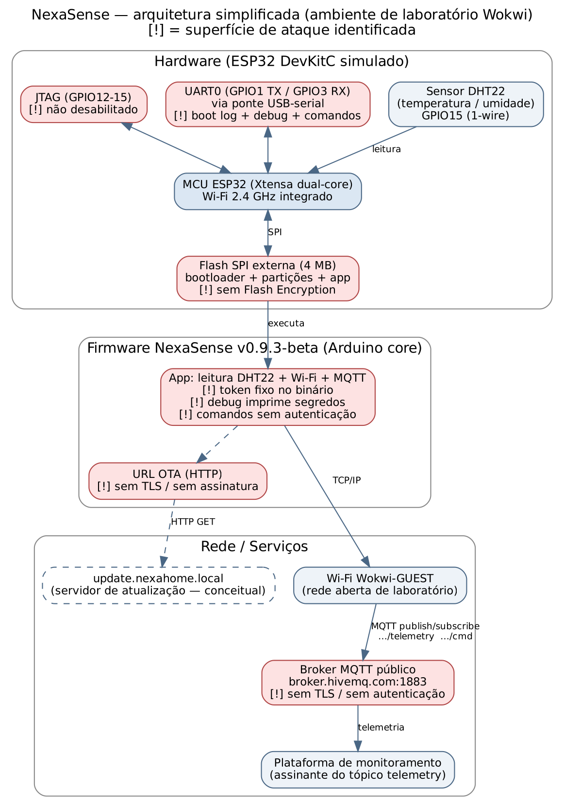

# NexaHome — Avaliação de Segurança do NexaSense (IoT / ESP32)

**Autor:** Ronald Araujo Viana — UniFECAF
**Projeto no simulador:** https://wokwi.com/projects/481366084517581825

## 1. Objetivo

Avaliar a segurança do protótipo **NexaSense** (sensor de temperatura e umidade com ESP32 e Wi-Fi) antes do projeto-piloto, identificando a superfície de ataque, demonstrando ao menos uma fragilidade de forma controlada, classificando os riscos e propondo um plano de hardening para a versão comercial.

## 2. Dispositivo analisado

| Componente | Detalhe |
|---|---|
| Placa | ESP32 DevKitC v4 (ESP32-WROOM-32), **simulada no Wokwi** |
| MCU | ESP32 dual-core Xtensa, Wi-Fi 2.4 GHz |
| Memória | Flash SPI externa (4 MB) + SRAM interna |
| Sensor | DHT22 (temperatura/umidade), GPIO15 |
| Interfaces | UART0 via USB, JTAG (GPIO12–15), modo download (GPIO0) |
| Alimentação | 5 V via USB (regulador 3,3 V na placa) |
| Firmware | NexaSense v0.9.3-beta (Arduino core) — educacional, com fragilidades inseridas de propósito |
| Comunicação | MQTT 3.1.1 → `broker.hivemq.com:1883` |

## 3. Escopo e limites

- Todos os testes foram feitos **somente no dispositivo simulado** e nos tópicos `nexahome-lab/NXS-000123/*`, criados para esta atividade.
- O broker `broker.hivemq.com` é um **broker público de testes**, oferecido para esse tipo de uso. Nenhum outro tópico, dispositivo ou serviço de terceiros foi acessado.
- Não houve testes contra redes de produção nem dispositivos reais.
- **Nenhum eFuse foi programado.** Secure Boot e Flash Encryption são apenas propostos.
- Todos os segredos do firmware (token, URLs) são **fictícios**.
- **Limitação principal:** sem placa física, não foi possível usar analisador lógico, JTAG, `esptool` nem capturar pacotes com o Wireshark. Esses pontos estão descritos com base na documentação oficial.

## 4. Arquitetura



```
Hardware ── MCU ESP32 · Flash SPI · DHT22 · UART/JTAG
   │
   ▼
Firmware ── leitura do sensor · Wi-Fi · cliente MQTT · debug · URL OTA
   │
   ▼
Protocolos ── Wi-Fi (Wokwi-GUEST) · MQTT/TCP 1883 (sem TLS) · HTTP (OTA)
   │
   ▼
Serviço ── broker MQTT → plataforma de monitoramento
```

## 5. Ferramentas

| Ferramenta | Uso |
|---|---|
| Wokwi | Simulação do ESP32 + DHT22, serial, Wi-Fi e compilação do firmware |
| Git Bash (`sha256sum`, `grep -a`, `cp`) | Preservação, hash e análise de strings do firmware |
| HiveMQ WebSocket Client | Teste de acesso anônimo ao broker MQTT |
| Graphviz | Diagrama de arquitetura |

## 6. Organização das evidências

```
nexahome-iot-security/
├── README.md
├── architecture/architecture-diagram.png
├── firmware/
│   ├── src/nexasense.ino          firmware analisado
│   ├── hashes.txt                 nome, tamanho, origem, data, SHA-256
│   ├── analysis-notes.md          análise de strings
│   ├── original/   (não versionado)  imagem original preservada
│   └── work/       (não versionado)  cópia de trabalho
├── hardware/
│   ├── interface-map.md
│   └── evidence/  01-boot-log-uart · 02-config-vazada-no-boot · 03-comando-debug-sem-auth
├── network/
│   ├── protocol-analysis.md
│   └── evidence/  01-mqtt-enviado · 02-teste-broker
├── findings/findings.md
└── remediation/hardening-plan.md
```

## 7. Resumos

**Firmware** — Imagem de 902.000 bytes, SHA-256 `c796e03c…e1d8cf36`, preservada antes da análise. A busca de strings encontrou o **token da API em texto puro**, a **URL de OTA em HTTP**, os domínios usados, os **tópicos MQTT** (incluindo `cmd`) e mensagens `[DEBUG]` que imprimem segredos. → [`firmware/analysis-notes.md`](firmware/analysis-notes.md)

**Hardware** — A UART0 fica acessível pelo próprio USB e exibe o boot log da ROM, a configuração completa (token, broker, OTA) e aceita comandos sem autenticação. O JTAG e o modo download continuam habilitados e a flash não é cifrada. → [`hardware/interface-map.md`](hardware/interface-map.md)

**Protocolos** — MQTT na porta 1883, sem TLS, sem usuário/senha nem certificado, com o token dentro do payload. O broker aceita publicação e assinatura anônimas. → [`network/protocol-analysis.md`](network/protocol-analysis.md)

## 8. Principais achados

| ID | Achado | Risco |
|---|---|---|
| F01 | Debug na UART imprime segredos no boot | Alto |
| F02 | Comandos sem autenticação (serial e MQTT) | Alto |
| F03 | Token de API fixo e em texto puro no firmware | Alto |
| F04 | MQTT sem TLS e broker sem autenticação | Alto |
| F05 | OTA via HTTP, sem assinatura | Médio |
| F06 | Flash sem cifragem e sem Secure Boot | Alto |
| F07 | Boot log da ROM exposto | Baixo |

**Demonstração controlada:** comando `config` enviado pela serial devolve a configuração completa, com o token, sem nenhuma autenticação (`hardware/evidence/03-comando-debug-sem-auth.png`).

Detalhes, evidências e relação com ETSI EN 303 645, NIST IR 8259A, OWASP ISTG e MITRE EMB3D: [`findings/findings.md`](findings/findings.md)

## 9. Recomendações

1. Build de produção sem debug e sem interface de comandos.
2. MQTT sobre TLS com certificado único por dispositivo e broker próprio com ACL.
3. Credenciais individuais por dispositivo, em NVS cifrada, fora do código-fonte.
4. Flash Encryption + Secure Boot V2, JTAG desabilitado e modo download seguro.
5. OTA via HTTPS com imagem assinada, anti-rollback e partições duplas para recuperação.

Plano completo: [`remediation/hardening-plan.md`](remediation/hardening-plan.md)

## 10. Como reproduzir (ambiente autorizado)

1. Abra o projeto no Wokwi (link no topo) ou crie um projeto ESP32 e cole `firmware/src/nexasense.ino`, com as bibliotecas **DHT sensor library for ESPx** e **PubSubClient**, e o DHT22 ligado em 3V3 / GND / GPIO15.
2. Clique em **Play** e observe a serial: boot log e bloco `[DEBUG] ===== CONFIG =====` (F01, F07).
3. Digite `config` na caixa da serial e aperte Enter: a configuração é devolvida sem autenticação (F02 — demonstração).
4. Aguarde `MQTT conectado` e as linhas `[MQTT] enviado` com o token no JSON (F04).
5. No cliente web da HiveMQ, conecte em `broker.hivemq.com:8884` (SSL), assine `nexahome-lab/#` e publique em `nexahome-lab/NXS-000123/cmd`: o broker aceita sem credencial (F04).
6. Firmware: no Wokwi, **F1 → Download Compiled Firmware**; depois, no Git Bash:
   ```bash
   sha256sum firmware/original/nexasense-v0.9.3.bin
   cp firmware/original/nexasense-v0.9.3.bin firmware/work/nexasense-work.bin
   grep -a -o -E "nxh_live_[A-Za-z0-9]+" firmware/work/nexasense-work.bin
   grep -a -o -E "https?://[[:print:]]+" firmware/work/nexasense-work.bin
   ```
   Observação: cada compilação gera um binário ligeiramente diferente, então o hash pode não bater com o registrado.

## 11. Caso real pesquisado

**LIFX Mini (lâmpada inteligente com ESP32), 2019** — o pesquisador LimitedResults abriu a lâmpada e, pela interface física da placa, extraiu a senha do Wi-Fi do usuário em texto puro da flash, além do certificado raiz e da chave privada RSA. O dispositivo não tinha Secure Boot, Flash Encryption nem JTAG desabilitado. A LIFX corrigiu passando a cifrar os dados sensíveis e ativando proteções de hardware. **Lição para a NexaHome:** é exatamente o cenário dos achados F03 e F06 — qualquer NexaSense descartado ou roubado entrega os segredos se a produção sair com a configuração padrão do ESP32. Detalhes no relatório.
